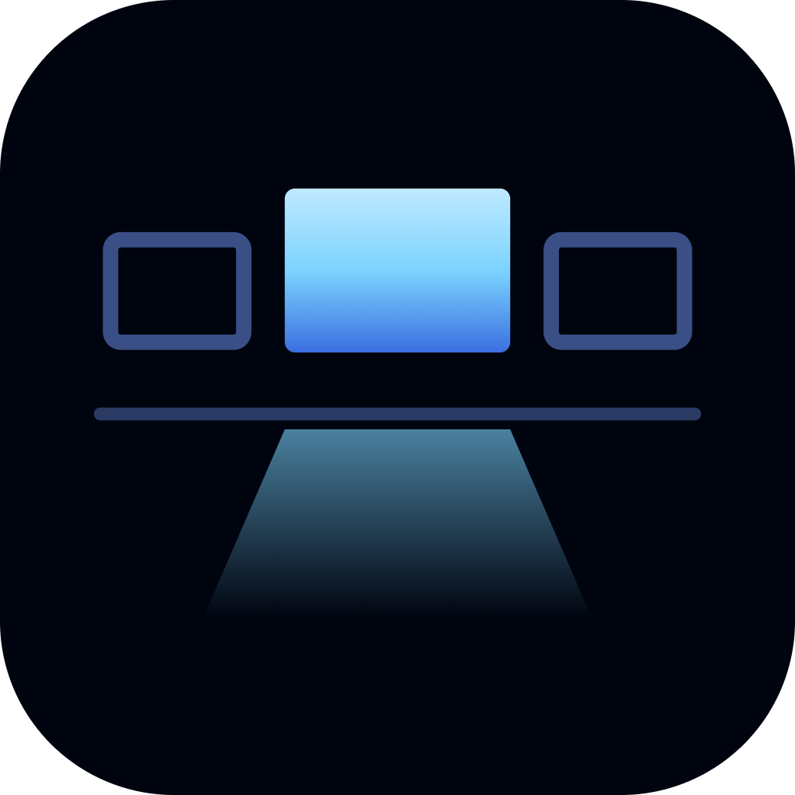
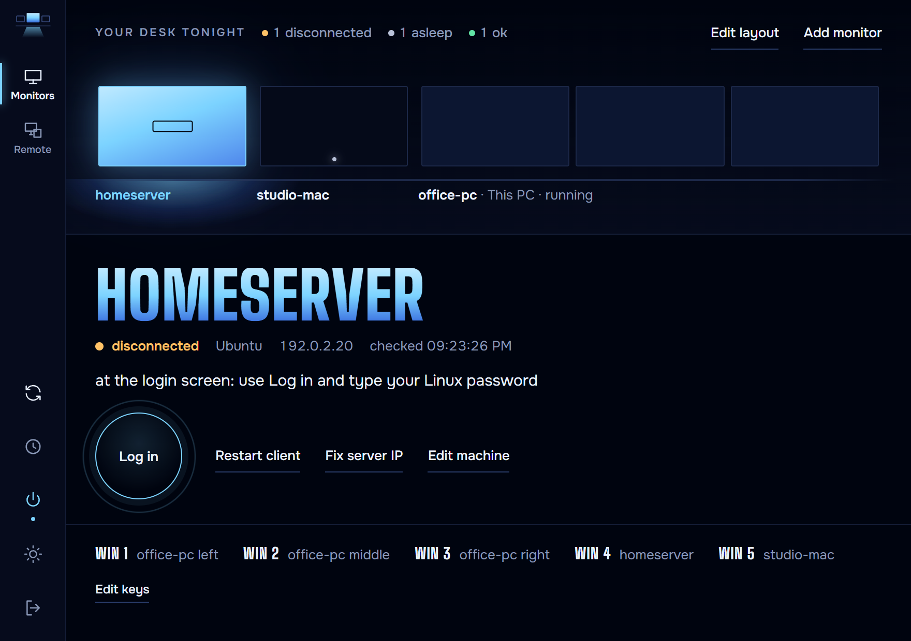
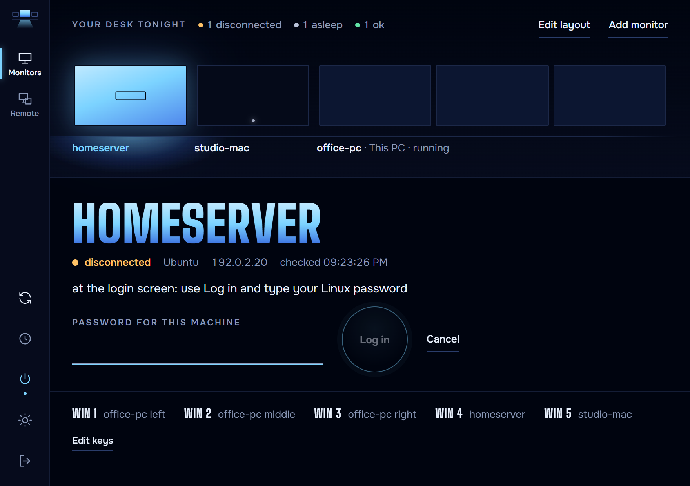
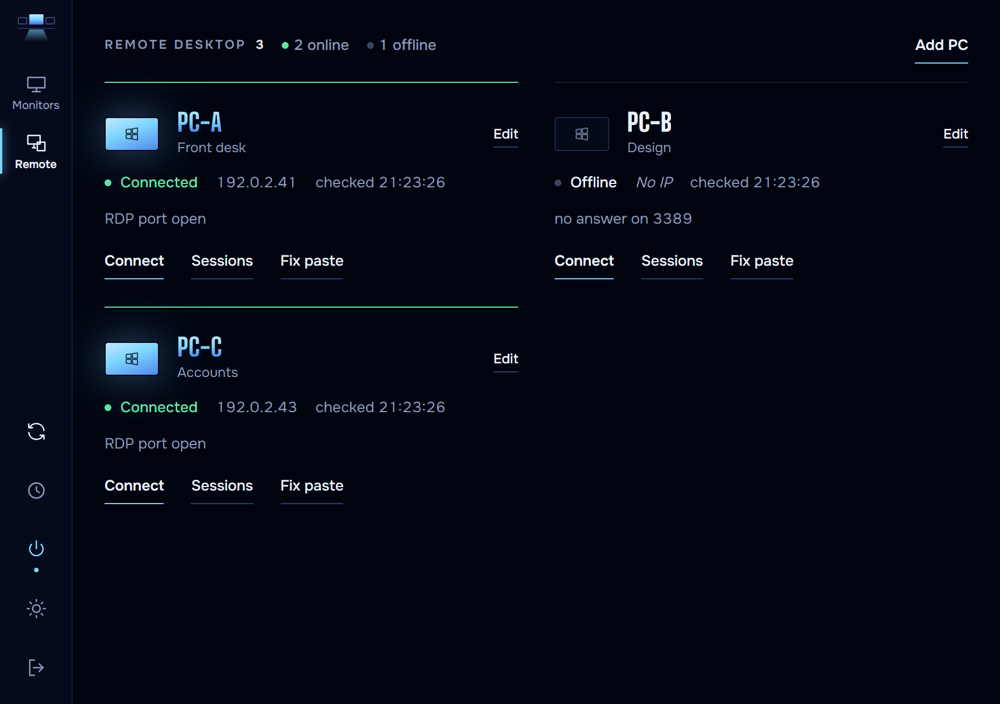
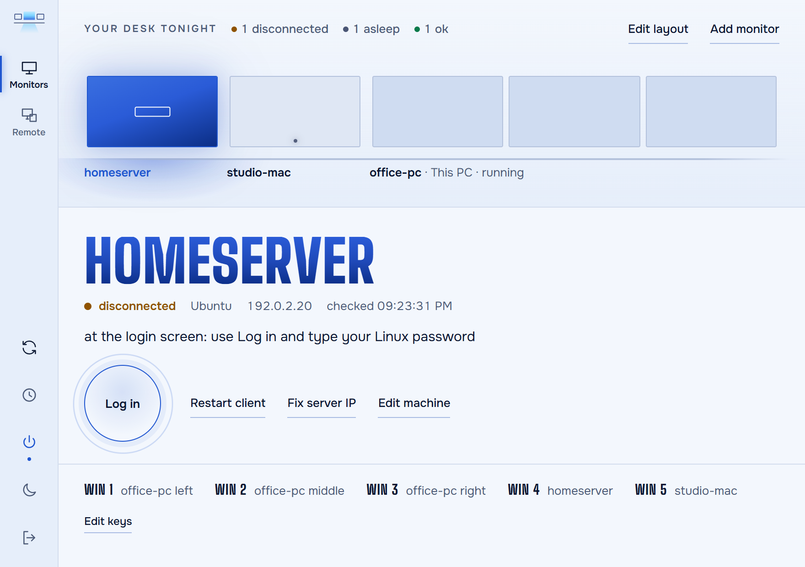

<div align="center">



# desk-monitor

**A tray app that keeps a Deskflow desk working.**<br>
When the mouse won't cross to a screen, it tells you why and gives you the button that fixes it.

[](https://github.com/joyahmed/desk-monitor/releases/latest) [](#install) [](#what-you-need) [](LICENSE)

### [⬇ Download desk-monitor](https://github.com/joyahmed/desk-monitor/releases/latest)

Free · No tracking · Rust + Tauri 2 + Svelte 5

<br>



</div>

<br>

## Why I built this

My desk has a Windows PC, an Ubuntu server and a Mac, each with its own monitor. Remote Desktop to the server kept freezing its picture, so I moved to [Deskflow](https://github.com/deskflow/deskflow): one keyboard and mouse for all three, and every machine draws its own screen.

It works well, until the mouse stops crossing to a screen. Then the question is always "why?" Is the machine off? Asleep? Sitting at its login screen? Is Deskflow stuck on a big clipboard copy? Finding out meant opening a terminal and checking by hand, every time.

So I built **desk-monitor**. It checks each machine, tells me in plain words what is wrong, and gives me the one button that fixes it. Every fix is a button I click. The one thing it does by itself: when it starts, it starts the Deskflow server if it isn't running.

## A quick look

<table>
  <tr>
    <td width="50%" valign="top">
      <br>
      <b>Log in from your own desk.</b> A Linux machine at its login screen gets a <b>Log in</b> button. Type the password here, it is never stored.
    </td>
    <td width="50%" valign="top">
      <br>
      <b>Your Remote Desktop PCs.</b> Who is online, connect in one click, see and log off sessions, fix a stuck paste.
    </td>
  </tr>
  <tr>
    <td width="50%" valign="top">
      <br>
      <b>Light or dark.</b> Both themes, one click apart.
    </td>
    <td width="50%" valign="top">
      <b>One key per screen.</b> Bind <kbd>Win</kbd> + numpad <kbd>1</kbd>…<kbd>9</kbd> to a screen. On the Windows PC a key can pick one of its monitors, and the cursor jumps to the middle of it.
    </td>
  </tr>
</table>

## Highlights

- 🩺 **Says why**: each machine shows `connected`, `hung`, `disconnected`, `asleep` or `offline`, with the reason.
- 🧊 **Catches the clipboard hang**: spots Deskflow stuck on a big clipboard copy, a known Deskflow bug.
- 🔁 **Restart the server**: restarts Deskflow through its own Windows service. No Deskflow window needed.
- 🔑 **Log in, restart, wake**: optional buttons per machine for a Linux login screen, a stuck client, or a sleeping Mac.
- 🧭 **Fix server IP**: when your PC's address changes, one click points the client back at it.
- 🗺 **Layout editor**: drag your screens into order and save. Deskflow's settings are backed up first.
- 🖥 **Remote Desktop tab**: a list of RDP PCs with online checks, sessions and a paste fix.
- 🫥 **Quiet**: lives in the tray, can start with Windows, and only ever opens one copy.

<details>
<summary><b>Everything it does</b> (click to open)</summary>

### Monitors tab (Deskflow)

- Status for each Deskflow client: `connected`, `hung`, `disconnected`, `asleep`, `offline` or `unknown`, with the reason. It reads the Deskflow server log, checks port 22, and runs short ssh checks.
- **Hung**: the client's Deskflow connection (port 24800) has more than 100 kB waiting to be read. That is Deskflow's known clipboard hang. Checked with `ss` on Linux and `netstat` on macOS.
- **Asleep** (macOS, best guess): disconnected, and nothing is keeping the Mac awake.
- **At the login screen** (Linux): nobody is logged in on the machine's own screen.
- **Restart Deskflow server** through the Deskflow Windows service.
- **Fix server IP**: writes this PC's current LAN address into the client's Deskflow settings (with a backup first). For networks without fixed addresses.
- **Restart client**, **Log in** and **Wake**: each one shows up only when you set it up for that machine (see [Set it up](#set-it-up)).
- **Layout editor**: put the screens in a left-to-right row. Saving rewrites the links in Deskflow's `server.conf` (backup first) and keeps your own options as they were.
- **Hotkeys**: bind <kbd>Win</kbd> + numpad <kbd>1</kbd>…<kbd>9</kbd> to a screen. Keys on the server PC can also pick one of its monitors; the cursor moves to its centre.
- **Desk name**: call your desk what you like with **Rename**.

### Remote Desktop tab

- Online check per PC (name lookup and port 3389).
- **Connect** opens Remote Desktop (`mstsc`).
- **Sessions** lists who is logged in (`qwinsta`), and you can log a session off.
- **Fix paste** restarts the clipboard helper (`rdpclip`) on the remote PC.
- Passwords are never stored. Windows Credential Manager keeps working as usual.

### App

- Lives in the tray. Closing the window hides it.
- When it starts, it starts the Deskflow server through its service if the server isn't running.
- Can start with Windows.
- Opening it a second time brings up the copy that is already running.

</details>

## Install

Download from the [Releases page](https://github.com/joyahmed/desk-monitor/releases/latest).

| System | File | First launch |
|---|---|---|
| **Windows 10 / 11** | `desk-monitor_<version>_x64-setup.exe` | Install it on the PC that runs the Deskflow **server**. It isn't signed yet, so Windows may warn you: click **More info**, then **Run anyway**. |

The Linux and Mac machines don't need desk-monitor. They only need Deskflow and ssh (see below).

## What you need

- Windows 10 or 11 on the PC that runs the Deskflow **server**.
- [Deskflow](https://github.com/deskflow/deskflow) 1.26, installed with its Windows service (the normal installer sets it up).
- For each Linux or Mac client: an ssh alias in `~/.ssh/config` that logs in **with a key and no password prompt**. desk-monitor runs `ssh -o BatchMode=yes`, so a password prompt just fails.
- Linux clients: the Deskflow Flatpak (`org.deskflow.deskflow`), `ss` and `loginctl`.
- Mac clients: the Deskflow app. `netstat` and `pmset` are built in.

## Watch it

See it working, and more of what I build: [youtube.com/@joysbuilds](https://www.youtube.com/@joysbuilds).

## Set it up

The machine list lives in `%APPDATA%\desk-monitor\machines.json`. On first start the app writes
one entry: this PC as the Deskflow server, named after the computer (Deskflow's default screen
name). Add the clients and RDP PCs with the app's machine form, or edit the file while the app is
closed.

Example with invented names and documentation addresses:

```json
{
  "machines": [
    {
      "id": "office-pc",
      "name": "Office PC",
      "os": "windows",
      "role": "deskflow-server",
      "host": "127.0.0.1",
      "deskflow_name": "office-pc"
    },
    {
      "id": "homeserver",
      "name": "Home server",
      "os": "linux",
      "role": "deskflow-client",
      "host": "10.0.0.5",
      "ssh_alias": "homeserver",
      "deskflow_name": "homeserver",
      "client_restart_command": "systemctl --user restart deskflow-client",
      "login_command": "sudo -n /usr/local/sbin/my-login-helper"
    },
    {
      "id": "studio-mac",
      "name": "Studio Mac",
      "os": "mac",
      "role": "deskflow-client",
      "host": "192.0.2.6",
      "ssh_alias": "studio-mac",
      "deskflow_name": "studio-mac",
      "wake_script": "C:\\Tools\\wake-studio-mac.ps1"
    },
    {
      "id": "pc-a",
      "name": "PC A",
      "os": "windows",
      "role": "rdp",
      "host": "PC-A"
    }
  ]
}
```

| Field | Meaning |
|---|---|
| `id` | Unique, lowercase. |
| `name`, `label` | What the app shows. `label` is optional. |
| `os` | `windows`, `linux` or `mac`. |
| `role` | `deskflow-server` (exactly one, this PC), `deskflow-client` or `rdp`. |
| `host` | Deskflow machines: a raw LAN IP (a Flatpak client cannot resolve `.local` names). RDP PCs: the PC **name**, because addresses move. |
| `ssh_alias` | Deskflow clients: the alias from your ssh config. |
| `deskflow_name` | The screen name in Deskflow's `server.conf`. Defaults to `name`. |
| `wake_script` | Optional. Full path to a local `.ps1` that wakes the machine (e.g. Wake-on-LAN). Shows a **Wake** button. |
| `login_command` | Optional. Command run over ssh that logs a user in on the machine's own screen. Shows a **Log in** button. |
| `client_restart_command` | Optional. Command run over ssh that restarts the Deskflow client there. Shows **Restart client**; **Fix server IP** also runs it after the change. |

Top level, next to `machines`: `desk_name` (optional) is your name for the desk, e.g. `"Ada's Desk"`;
the Monitors tab shows it instead of "Your desk". You can also set it with **Rename** in the app.

A button whose field is unset is hidden, not broken. Hotkeys are stored in the same file under
`hotkeys` once you save them in the app.

### The `login_command` contract

desk-monitor asks for the password in place, then runs the command over ssh with the password as
**line 1 of stdin**. The password is never stored or logged by the app. The command must exit:

- `0` - logged in (anything it prints on stdout is shown);
- `3` - wrong password, nothing changed;
- `4` - a log in is already running;
- anything else - failure; stdout or stderr is shown.

It exists because a Wayland login screen (GNOME, for example) cannot be driven by Deskflow's
mouse. A ready helper for GNOME/GDM (tested on Ubuntu 26.04) is in
[examples/linux-login](examples/linux-login): it checks the password with PAM, switches autologin on
for that one login only, and ships a gdm fail-safe so a power cut mid-login still boots to the
password screen. Install steps are at the top of `login-helper.sh`. It runs with `sudo -n` from a
narrow sudoers rule, never with a stored password.

### Restart commands

Deskflow has no standard way to restart a client from another machine; it depends on how the
client is started there. Some examples:

- Linux, client run by a systemd user unit: `systemctl --user restart deskflow-client`
- macOS, client run by your own LaunchAgent `com.example.deskflow-client`:
  `launchctl kickstart -k gui/$(id -u)/com.example.deskflow-client`

Do not use `pkill -f` in these commands: over ssh it matches and kills the ssh shell itself. Use
`pgrep -x deskflow-core` and `kill` the pids instead.

### Client settings paths used by Fix server IP

These are Deskflow's own settings files:

- Linux (Flatpak): `~/.var/app/org.deskflow.deskflow/config/Deskflow/Deskflow.conf`
- macOS: `~/Library/Deskflow/Deskflow.conf`

### A note on the Deskflow service

desk-monitor restarts the server through the Deskflow Windows service (`deskflow-daemon`), the
same way the Deskflow window does: it sends one-line messages over the named pipe
`\\.\pipe\deskflow-daemon` (`hello`, `elevate=yes`, `command=...`, `start`). The service then runs
the server core elevated in your session, restarts it if it dies, and starts it at boot.

That protocol is internal to Deskflow and **has no version check**. It was read from Deskflow
1.26.0 (`lib/deskflow/ipc/DaemonIpcServer.cpp`). After a Deskflow upgrade, check that
**Restart Deskflow server** still works; the server status shows a warning when the installed
Deskflow is not 1.26.x.

## Build from source

You need [Bun](https://bun.sh), [Rust](https://rustup.rs) and the [Tauri 2 prerequisites](https://v2.tauri.app/start/prerequisites/) for Windows.

```
bun install
bun run tauri dev        # run it while you work on it
bun run tauri build      # installer in src-tauri/target/release/bundle/
bun run gate             # every check: blocks, svelte-check, build, cargo fmt, clippy and tests
```

Tests that touch a real client are skipped by default. Run them with
`DESK_MONITOR_LIVE_CLIENT=<machine id> cargo test -- --ignored` from `src-tauri`.

It's Rust and Tauri 2 on the back, Svelte 5 on the front.

## Privacy

- No telemetry, no analytics, no account.
- It only talks to the machines you list, over ssh, TCP checks and Remote Desktop.
- Passwords are never stored or logged. The **Log in** password goes to your own login command and nowhere else.

## License

MIT. See [LICENSE](LICENSE). The bundled fonts (Big Shoulders Display, Onest) are under the SIL Open Font License 1.1, see [static/fonts/LICENSE-OFL.txt](static/fonts/LICENSE-OFL.txt).
Not affiliated with the Deskflow project.

---

<div align="center">

I build tools I use myself, from Bangladesh. If desk-monitor saves you a trip to a terminal, that makes me happy.<br>
Found a bug or want something? [Open an issue](https://github.com/joyahmed/desk-monitor/issues).

**Joy**

</div>
