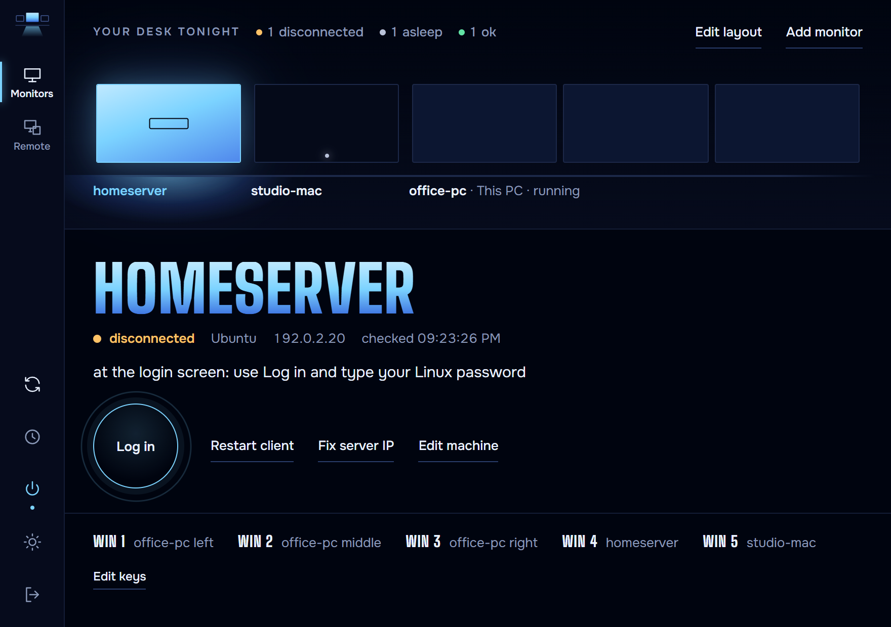
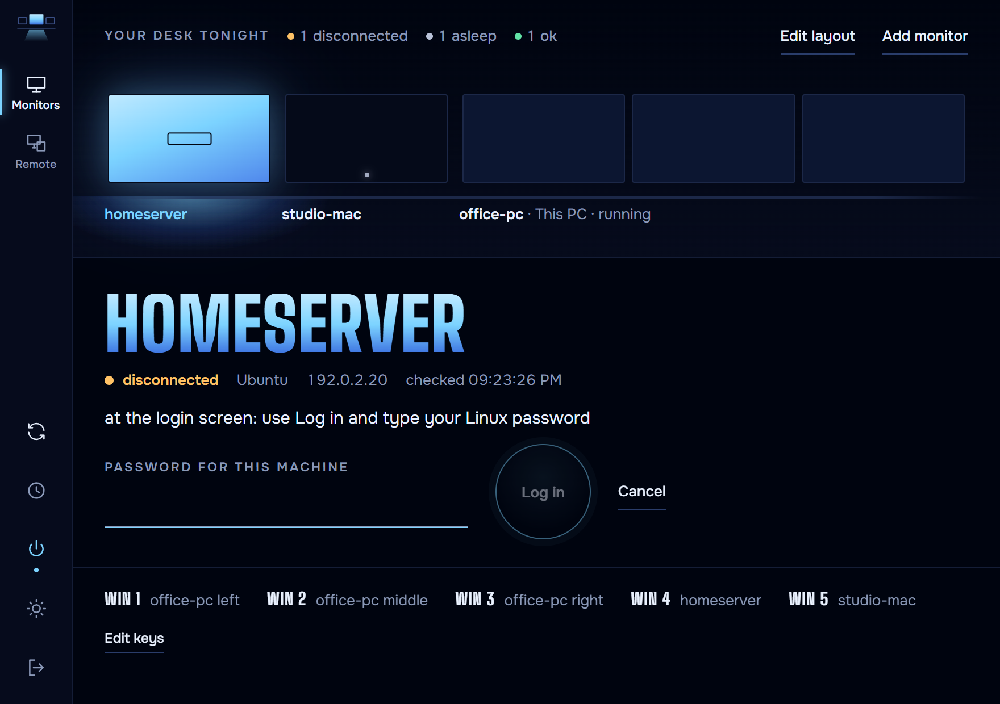
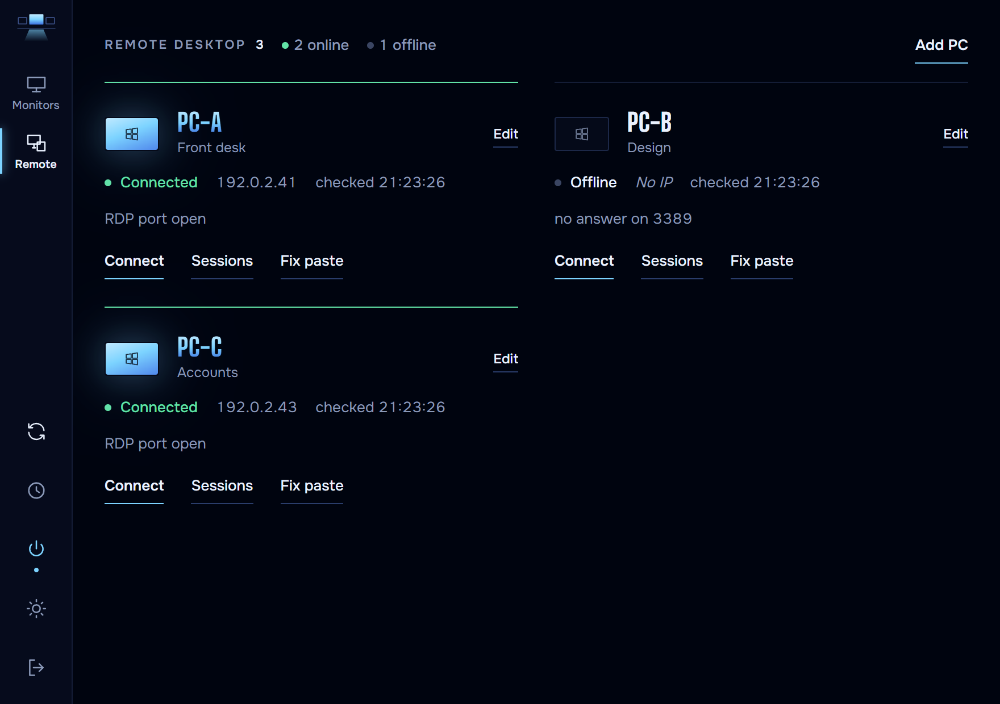
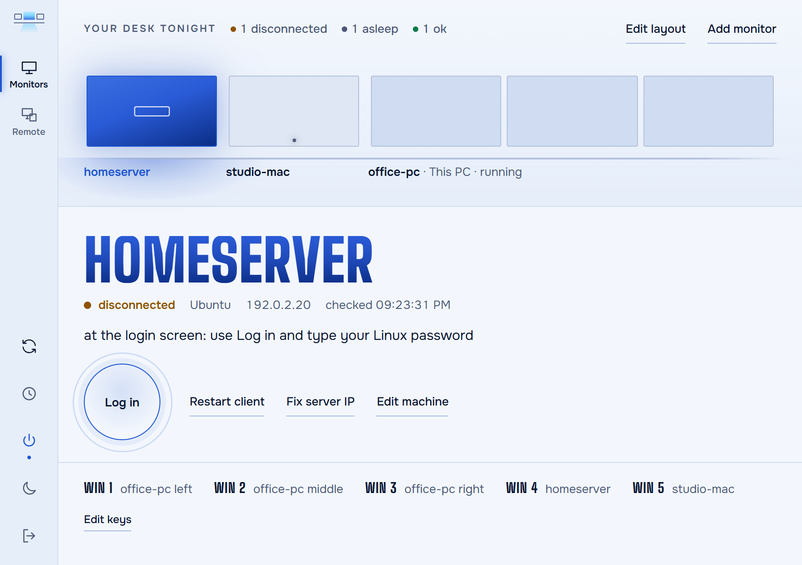

# desk-monitor

A Windows tray app that watches and fixes a [Deskflow](https://github.com/deskflow/deskflow)
setup: one keyboard and mouse shared across Windows, Linux and macOS machines.

When the mouse stops crossing to a screen, desk-monitor tells you why (client offline, hung,
asleep, at its login screen) and gives you the button that fixes it. It also keeps a list of
Remote Desktop PCs with their sessions.

Built with Tauri 2, Svelte 5 and Rust. Nothing runs on its own: every fix is a button you click.



| Log in to a Linux login screen | Remote Desktop PCs | Light theme |
|---|---|---|
|  |  |  |

## Download

Get the Windows installer (`desk-monitor_x.y.z_x64-setup.exe`) from the
[Releases](../../releases) page, or build it yourself (see [Build](#build)).

## Features

**Monitors tab (Deskflow)**

- Status per Deskflow client: `connected`, `hung`, `disconnected`, `asleep`, `offline`,
  `unknown`, with the reason. Read from the server log
  (`C:\ProgramData\Deskflow\deskflow-core.log`), a TCP check on port 22, and short ssh checks:
  - hung: the client's Deskflow socket (port 24800) has a receive queue over 100 kB, the known
    clipboard-chunk hang (`ss` on Linux, `netstat` on macOS);
  - asleep (macOS, best effort): disconnected and no `caffeinate` power assertions;
  - at the login screen (Linux): no user session on seat0 (`loginctl`).
- **Restart Deskflow server** through the Deskflow Windows service. No Deskflow window needed.
- **Fix server IP**: rewrites `remoteHost=` in the client's Deskflow settings to this PC's current
  private LAN address (backup first), for networks without fixed addresses.
- Optional per machine (see below): **Restart client**, **Log in**, **Wake**.
- Layout editor: put the screens in a left-to-right row; saving rewrites the `links` of
  Deskflow's `server.conf` (backup first) and keeps your `options` block as it was.
- Win+numpad hotkeys: bind keys 1-9 to a screen. Keys bound to the server can also pick one of
  its monitors; the app then moves the cursor to that monitor's centre.

**Remote Desktop tab**

- Online check per PC (name lookup + TCP 3389), Connect (`mstsc`), list sessions (`qwinsta`),
  log a session off, and fix a stuck clipboard (restarts `rdpclip` on the remote PC).
- Passwords are never stored; Windows Credential Manager keeps working as usual.

**App**

- Lives in the tray; closing the window hides it. Optional start with Windows.

## Requirements

- Windows 10 or 11 on the PC that runs the Deskflow **server**.
- [Deskflow](https://github.com/deskflow/deskflow) 1.26 installed with its Windows service
  (the default installer sets it up). desk-monitor talks to that service, see the note below.
- For each Linux or macOS client: an ssh alias in `~/.ssh/config` that logs in **with a key and
  no prompt** (desk-monitor runs `ssh -o BatchMode=yes`, so a password prompt simply fails).
- Linux clients: the Deskflow Flatpak (`org.deskflow.deskflow`), `ss` and `loginctl`.
  macOS clients: the Deskflow app; `netstat` and `pmset` are built in.
- To build: [Bun](https://bun.sh), [Rust](https://rustup.rs) and the
  [Tauri 2 prerequisites](https://v2.tauri.app/start/prerequisites/) for Windows.

## Configuration: machines.json

The machine list lives in `%APPDATA%\desk-monitor\machines.json`. On first start the app writes
one entry: this PC as the Deskflow server, named after the computer (Deskflow's default screen
name). Add the clients and RDP PCs with the app's machine form, or edit the file while the app is
closed.

Example with invented names and documentation addresses:

```json
{
  "machines": [
    {
      "id": "office-pc",
      "name": "Office PC",
      "os": "windows",
      "role": "deskflow-server",
      "host": "127.0.0.1",
      "deskflow_name": "office-pc"
    },
    {
      "id": "homeserver",
      "name": "Home server",
      "os": "linux",
      "role": "deskflow-client",
      "host": "10.0.0.5",
      "ssh_alias": "homeserver",
      "deskflow_name": "homeserver",
      "client_restart_command": "systemctl --user restart deskflow-client",
      "login_command": "sudo -n /usr/local/sbin/my-login-helper"
    },
    {
      "id": "studio-mac",
      "name": "Studio Mac",
      "os": "mac",
      "role": "deskflow-client",
      "host": "192.0.2.6",
      "ssh_alias": "studio-mac",
      "deskflow_name": "studio-mac",
      "wake_script": "C:\\Tools\\wake-studio-mac.ps1"
    },
    {
      "id": "pc-a",
      "name": "PC A",
      "os": "windows",
      "role": "rdp",
      "host": "PC-A"
    }
  ]
}
```

| Field | Meaning |
|---|---|
| `id` | Unique, lowercase. |
| `name`, `label` | What the app shows. `label` is optional. |
| `os` | `windows`, `linux` or `mac`. |
| `role` | `deskflow-server` (exactly one, this PC), `deskflow-client` or `rdp`. |
| `host` | Deskflow machines: a raw LAN IP (a Flatpak client cannot resolve `.local` names). RDP PCs: the PC **name**, because addresses move. |
| `ssh_alias` | Deskflow clients: the alias from your ssh config. |
| `deskflow_name` | The screen name in Deskflow's `server.conf`. Defaults to `name`. |
| `wake_script` | Optional. Full path to a local `.ps1` that wakes the machine (e.g. Wake-on-LAN). Shows a **Wake** button. |
| `login_command` | Optional. Command run over ssh that logs a user in on the machine's own screen. Shows a **Log in** button. |
| `client_restart_command` | Optional. Command run over ssh that restarts the Deskflow client there. Shows **Restart client**; **Fix server IP** also runs it after the change. |

A button whose field is unset is hidden, not broken. Hotkeys are stored in the same file under
`hotkeys` once you save them in the app.

### The `login_command` contract

desk-monitor asks for the password in place, then runs the command over ssh with the password as
**line 1 of stdin**. The password is never stored or logged by the app. The command must exit:

- `0` - logged in (anything it prints on stdout is shown);
- `3` - wrong password, nothing changed;
- `4` - a log in is already running;
- anything else - failure; stdout or stderr is shown.

It exists because a Wayland login screen (GNOME, for example) cannot be driven by Deskflow's
mouse. A ready helper for GNOME/GDM (tested on Ubuntu 26.04) is in
[examples/linux-login](examples/linux-login): it checks the password with PAM, switches autologin on
for that one login only, and ships a gdm fail-safe so a power cut mid-login still boots to the
password screen. Install steps are at the top of `login-helper.sh`. It runs with `sudo -n` from a
narrow sudoers rule, never with a stored password.

### Restart commands

Deskflow has no standard way to restart a client from another machine; it depends on how the
client is started there. Some examples:

- Linux, client run by a systemd user unit: `systemctl --user restart deskflow-client`
- macOS, client run by your own LaunchAgent `com.example.deskflow-client`:
  `launchctl kickstart -k gui/$(id -u)/com.example.deskflow-client`

Do not use `pkill -f` in these commands: over ssh it matches and kills the ssh shell itself. Use
`pgrep -x deskflow-core` and `kill` the pids instead.

### Client settings paths used by Fix server IP

These are Deskflow's own settings files:

- Linux (Flatpak): `~/.var/app/org.deskflow.deskflow/config/Deskflow/Deskflow.conf`
- macOS: `~/Library/Deskflow/Deskflow.conf`

## Build

```sh
bun install
bun run tauri build      # installer in src-tauri/target/release/bundle/
bun run tauri dev        # development
bun run gate             # all checks: blocks, svelte-check, build, cargo fmt/clippy/test
```

Live tests that touch a real client are ignored by default. Run them with
`DESK_MONITOR_LIVE_CLIENT=<machine id> cargo test -- --ignored` from `src-tauri`.

## A note on the Deskflow service

desk-monitor restarts the server through the Deskflow Windows service (`deskflow-daemon`), the
same way the Deskflow window does: it sends one-line messages over the named pipe
`\\.\pipe\deskflow-daemon` (`hello`, `elevate=yes`, `command=...`, `start`). The service then runs
the server core elevated in your session, restarts it if it dies, and starts it at boot.

That protocol is internal to Deskflow and **has no version check**. It was read from Deskflow
1.26.0 (`lib/deskflow/ipc/DaemonIpcServer.cpp`). After a Deskflow upgrade, check that
**Restart Deskflow server** still works; the server status shows a warning when the installed
Deskflow is not 1.26.x.

## Licence

MIT, see [LICENSE](LICENSE). The bundled fonts (Big Shoulders Display, Onest) are under the SIL
Open Font License 1.1, see [static/fonts/LICENSE-OFL.txt](static/fonts/LICENSE-OFL.txt).
Not affiliated with the Deskflow project.
